<p align="center">
  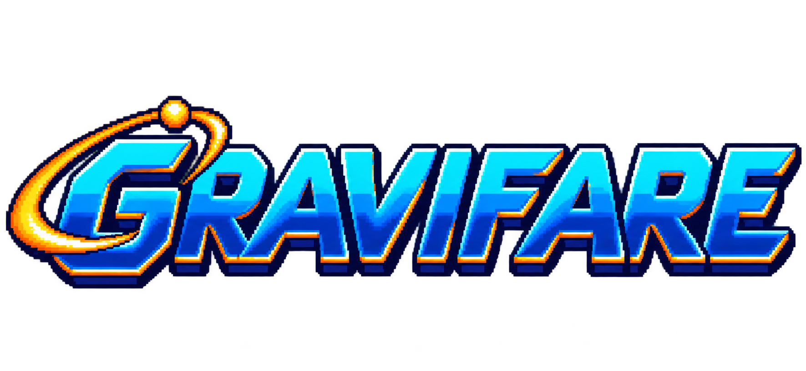
</p>

<p align="center"><a href="#deutsch">Deutsch</a> · <a href="#english">English</a></p>

<p align="center"><b>Eine schwerelose Fahrt · A weightless ride</b><br>
Ein Schwebetaxi-Arcadespiel in Godot 4.7 – Trägheit, Schwerkraft, präzise Landungen.<br>
A hover-taxi arcade game in Godot 4.7 – inertia, gravity, precise landings.</p>

<p align="center">
  <a href="https://github.com/floppi77/gravifare/actions/workflows/regression.yml"></a>
  <a href="https://github.com/floppi77/gravifare/actions/workflows/security.yml"></a>
  <a href="https://ko-fi.com/floppi77"></a>
</p>

<p align="center">
  <a href="https://github.com/floppi77/gravifare/releases/latest"><b>⬇ Download (Windows · Linux · macOS)</b></a>
</p>

# Deutsch

<p align="center">
  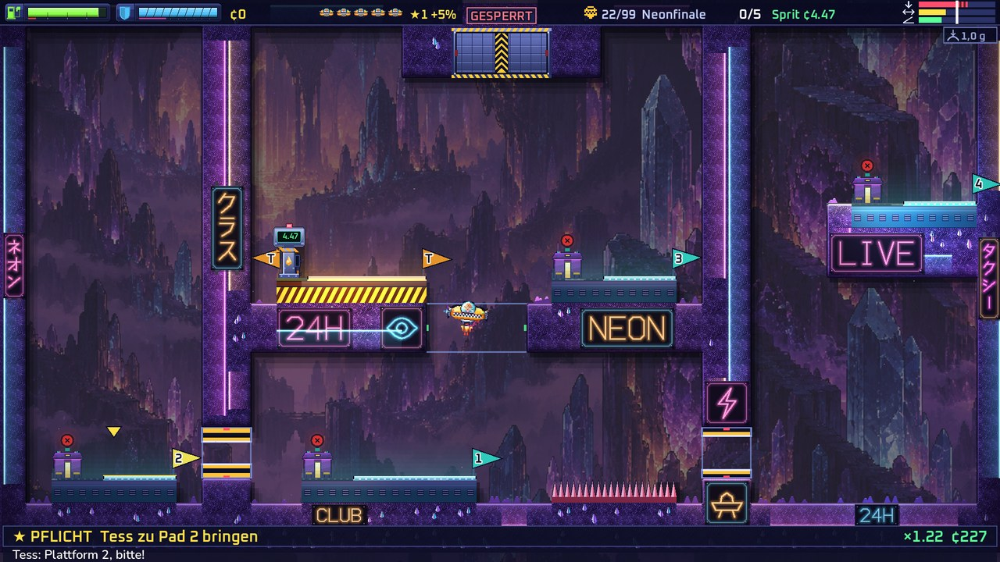
</p>

GraviFare ist ein 2D-Arcade-Taxispiel: Du fliegst ein Schwebetaxi durch **99 Level in 9 Sektoren**, holst Fahrgäste ab,
setzt sie an der richtigen Plattform ab und landest dabei so sanft wie möglich. Der Sprit kostet Credits, jede Beule die
Hülle – und das Taxi hat Schwung. Eine Hommage an das Genre der Flugtaxi-Spiele, mit eigener Welt, eigenen Leveln,
eigener Grafik und eigenem Klang. Neben der Karriere gibt es jeden Tag eine **Tagschicht** und eine **Nachtschicht**, mit der
**Sonderschicht** einen Roguelike-Modus und einen **Level-Editor** für eigene Level.

## Trailer

<p align="center">
  <a href="docs/media/trailer_de.mp4">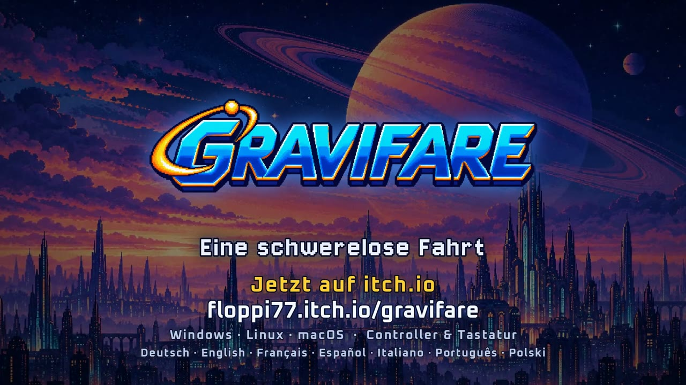</a><br>
  <sub>▶ Trailer ansehen (1080p60, 72 s) · <a href="docs/media/trailer_en.mp4">English version</a></sub>
</p>

Alles im Trailer stammt aus dem echten Spiel und den 99 handgemachten Leveln (Autopilot-Flüge, aufgenommen mit Godots Movie Maker); Schnitt, Kamera und Effekte entstehen per Skript, siehe [tools/trailer](tools/trailer/README.md).

## Galerie

| | |
|---|---|
| 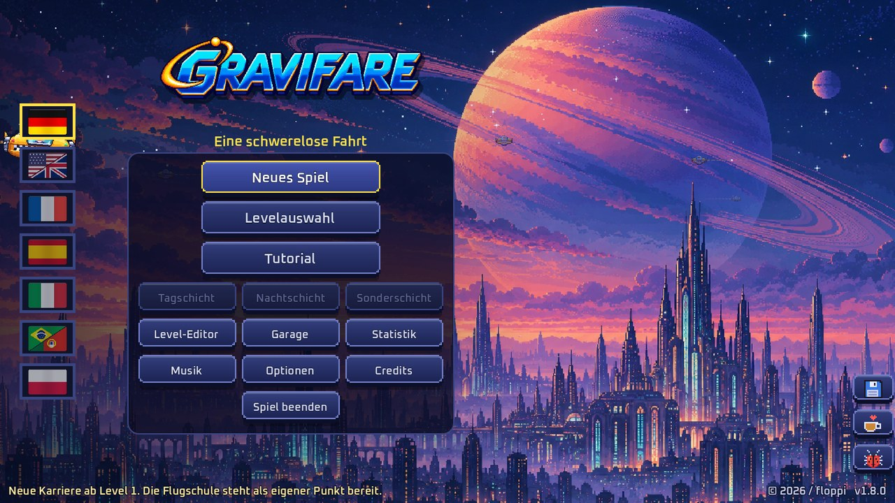 | 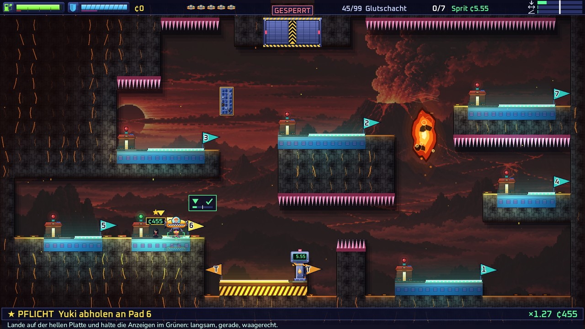 |
| **Hauptmenü** | **Sektor 5 – Hitze und Lavablasen im Takt** |
| 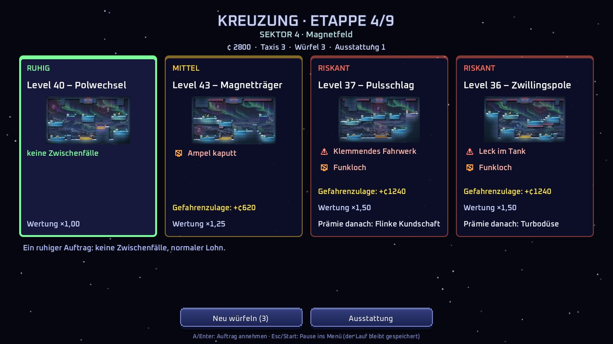 |  |
| **Sonderschicht (Roguelike) – an der Kreuzung einen Auftrag wählen** | **Sonderschicht – Zwischenfälle ändern das Fluggefühl (hier: schwache Seitendüse)** |
| 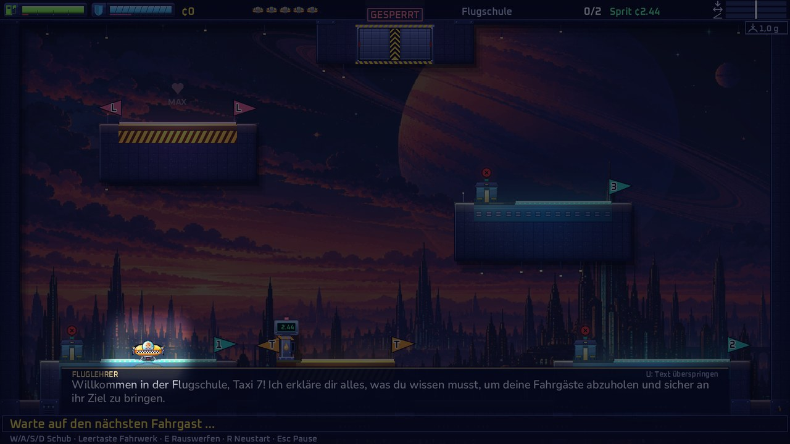 | 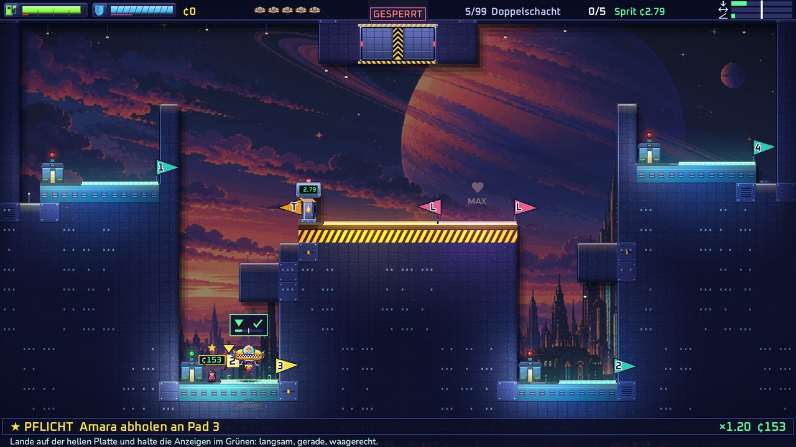 |
| **Flugschule mit Fluglehrer (Stimme, Untertitel, Hinweise)** | **Sektor 1 – Fahrgäste, Tankstelle, Tor** |
| 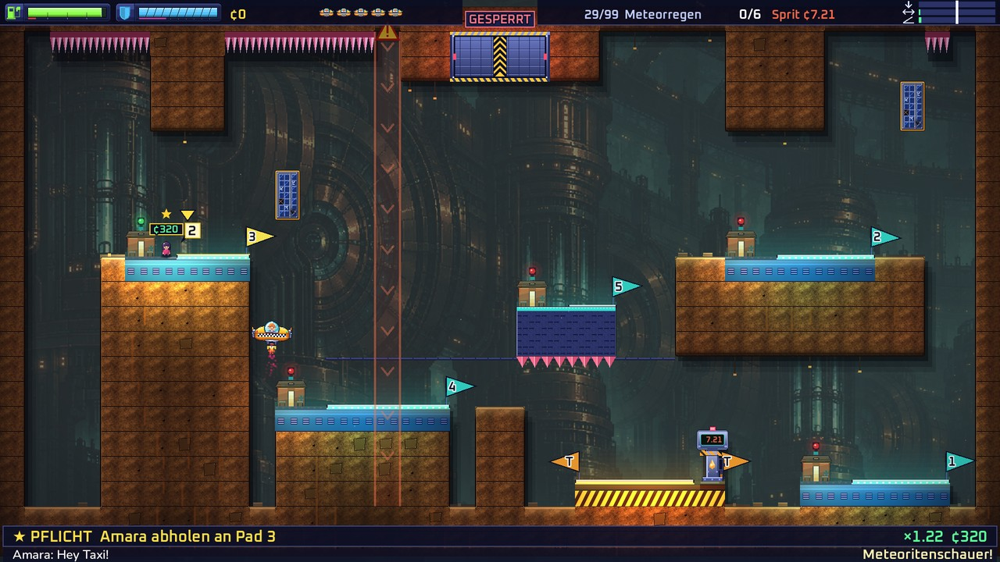 | 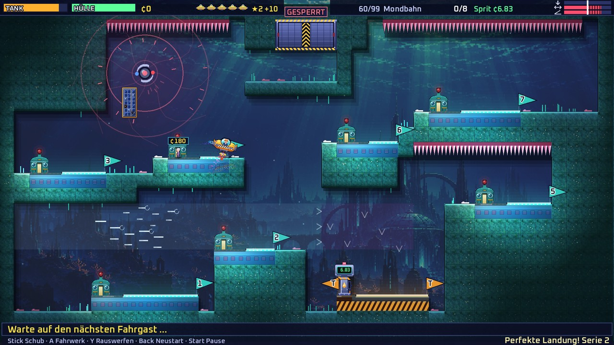 |
| **Sektor 3 – bewegliche Plattformen** | **Sektor 6** |
|  | 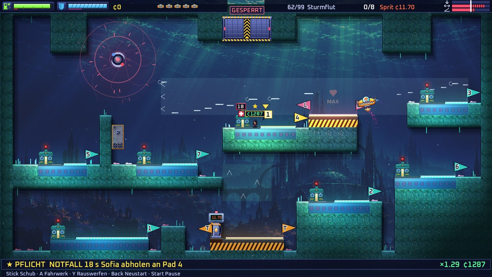 |
| **Neon-Schluchten – Leuchtreklame aus Röhren** | **Notfall – Fahrgast mit Frist und Countdown** |
| 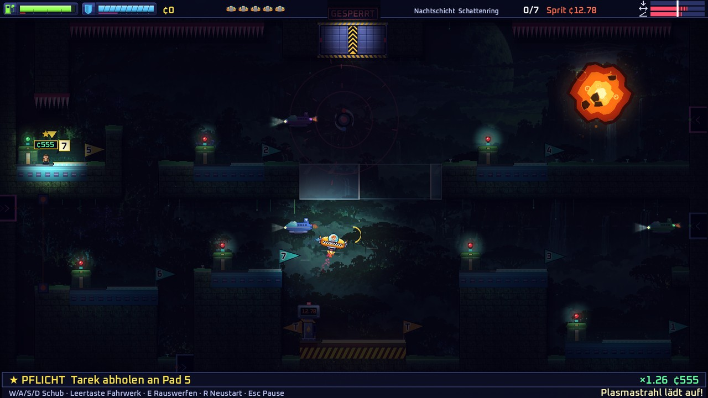 | 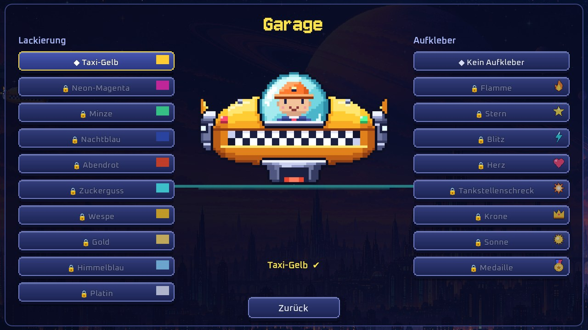 |
| **Nachtschicht – im Dunkeln leuchten nur Lampen und Scheinwerfer** | **Garage – Lackierungen und Aufkleber** |
|  | 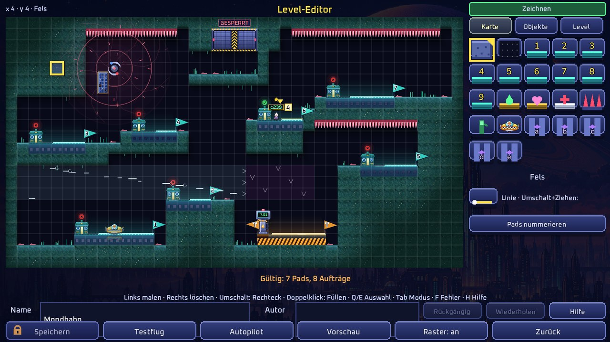 |
| **Werkstatt – Düsen, Hülle, Fahrwerk und Scheinwerfer aufrüsten** | **Level-Editor – eigene Level bauen, testen und teilen** |

## Was drinsteckt

- **99 handgemachte Level in 9 Sektoren** mit steigender Schwierigkeit: Tore, bewegliche Plattformen, Meteoriten, Hitze, Lavablasen,
  Fremdverkehr, wechselnde Schwerkraft. Jedes Level wurde von Hand gebaut, abgestimmt und selbst durchgeflogen – nichts davon ist zufallsgeneriert.
- **Flugschule:** ein vertontes Tutorial mit Fluglehrer erklärt Schub, Fahrwerk, Landeampel, Tanken, Taxistation und Fahrgäste.
- **Karriere mit Leben und Credits:** Fahrpreise, Spritkosten, Reparaturen, Ersatztaxis und eine **Werkstatt** nach jedem Sektor
  (Düsen, Hülle, Fahrwerk, Scheinwerfer). Game Over setzt den Sektor zurück, jeder Einbau verliert eine Stufe. Fahrgäste mit Sonderwünschen: **VIP** (zahlt fast doppelt, wenig Geduld) und **Notfall** (doppelter Preis, Frist in Sekunden).
- **Landeassistent** direkt am Taxi, Medaillen (Zeit, sauber, Profi), Bestzeit-Geist und **Bestflug ansehen** in der Levelauswahl, **Garage** mit Lackierungen und Aufklebern.
- **Tagschicht** (frei nach Abschluss von Sektor 1): Jeden Tag wartet eine hell beleuchtete Karte aus den schon geschafften Leveln, dazu eine **Tagesregel**, die das Fliegen verändert – Windtag, Nebel, Spiegelwelt, Dünner Tank, Glasdach, Eilfahrt oder Rückenwind, jede Woche neu auf die Wochentage verteilt. Ein **Tagesziel** (Express, Präzision, Sauber oder Gewinn) bringt Bronze, Silber oder Gold. Wer täglich fliegt, baut eine Serie auf und schaltet damit Lackierungen und Aufkleber frei; der beste Flug des Tages fliegt als Geist mit.
- **Nachtschicht** (frei nach Abschluss von Sektor 4): eine Schicht pro Tag aus **9 Karten**, eine je Sektor, die immer dunkler werden, bis nur noch Lampen und Scheinwerfer leuchten. Am selben Tag fliegen alle dieselbe Strecke mit denselben Aufträgen, und es gibt **nur einen Versuch**. Die Pflichtfahrgäste haben kein Zeitlimit; gewertet werden Wartezeit, Landungen, Hülle und knappe Vorbeiflüge, dazu übrige Taxis und Credits. Am Ende steht eine **Note von S bis E**.
- **Sonderschicht** – der Roguelike-Modus (frei nach Abschluss von Sektor 6 oder auf Wunsch sofort beim neuen Spielstand): 9, 18 oder 27 Etappen durch alle Sektoren. An jeder Kreuzung wählst du einen Auftrag mit Zwischenfällen, die das Fluggefühl von Level zu Level teils stark verändern (heiße Düse, klemmendes Fahrwerk, träge Düsen, schwache Seitendüse, Schmierfilm …) oder ans Geld gehen (Barzahler, Steuerprüfung). Im Werkstatt-Halt gibt es Ausstattung aus 46 Teilen, dazu Pakte, Lizenzen, Dienstgrade, Überstunden-Stufen und eine Bestenliste. Seed frei wählbar; die Level bleiben die handgemachten.
- **Level-Editor:** eigene Level bauen (Editor mit der echten Spielansicht, per Maus, Tastatur und Controller) sowie geteilte Level einlesen und spielen (Code aus der Zwischenablage oder Datei), mit strenger Prüfung und getrennt von der Karriere. Gespeichert wird nur, was der Ersteller selbst von Hand gelöst hat ([Format und Regeln](docs/COMMUNITY.md)).
- **Sprachausgabe** für Fahrgäste (14 verschiedene Stimmen, je Fahrgast zufällig gewählt), Tankwart, Funk-Zentrale und Fluglehrer, **Deutsch, Englisch, Französisch, Spanisch, Italienisch, Portugiesisch und Polnisch** mit Untertiteln.
- **Soundtrack** mit 23 Musikthemen in je drei Schichten (C64- und Amiga-Klang) und eigenem Musikplayer.
- **Steuerung:** Tastatur und Gamepad (Xbox-Layout) mit Vibration, alle Tasten frei belegbar, siehe [CONTROLS.md](CONTROLS.md).
- **Anzeige:** 16:9, 1440p/2160p und Ultrawide, drei Speicherplätze.
- **Bedienhilfen:** Farbtafel für Farbsehschwäche (Ampel, Tank, Preise und Lampen in Blau, Gelb und Purpurrot), große Schrift für HUD und Untertitel, weniger Bewegung, Landehilfe.
- **Bug melden** direkt aus dem Hauptmenü: öffnet eine E-Mail mit Betreff und Systemangaben, dazu der Protokollordner.

## Herunterladen und spielen

Unter [Releases](https://github.com/floppi77/gravifare/releases/latest) liegen fertige Pakete für **Windows (x86-64)**,
**Linux (x86-64)** und **macOS (Apple Silicon und Intel)**. Entpacken und starten:

| Plattform | Datei | Start |
|---|---|---|
| Windows | `GraviFare-<Version>-windows-x86_64.zip` | `gravifare.exe` |
| Linux | `GraviFare-<Version>-linux-x86_64.zip` | `./gravifare.x86_64` (ggf. `chmod +x`) |
| macOS | `GraviFare-<Version>-macos-universal.zip` | `GraviFare.app` (nicht signiert: Rechtsklick › Öffnen) |

Prüfsummen stehen in `SHA256SUMS.txt`. Die Pakete sind nicht signiert; Windows und macOS warnen deshalb beim ersten Start.

## Aus dem Quelltext bauen

Godot 4.7.x und die passenden Exportvorlagen vorausgesetzt:

```bash
godot --headless --import                # einmal nach dem Checkout
godot --path .                           # Spiel starten
godot --headless -s tests/test_runner.gd # Tests (über 4200 Prüfungen)
tools/export_release.sh                  # Pakete für Linux, Windows, macOS nach build/release/
```

Weitere Hinweise und Entwickler-Aufrufe stehen weiter unten und in [DESIGN.md](DESIGN.md), [LEVELS.md](LEVELS.md), [TESTING.md](TESTING.md).

## Herkunft und Lizenzen

Hintergrundbilder und Logo sind KI-generiert. Die Sprecherstimmen sind künstlich: Fahrgäste, Tankwart und Zentrale
mit Qwen3-TTS (Apache-2.0); die Fluglehrer-Stimme im Tutorial und zehn weitere Fahrgaststimmen sind **Built with Fish Audio** (Drama 3). Fremdbestandteile: [THIRD_PARTY_NOTICES.md](THIRD_PARTY_NOTICES.md), [THIRD_PARTY_LICENSES.md](THIRD_PARTY_LICENSES.md),
[CREDITS.md](CREDITS.md). Der Titel ist vorläufig. **Lizenz:** frei für nicht-kommerzielle Zwecke – Code unter [PolyForm Noncommercial 1.0.0](LICENSE), Inhalte (Grafik, Musik, Stimmen, Level) unter [CC BY-NC-SA 4.0](LICENSE-ASSETS.md).

---

# English

<p align="center">
  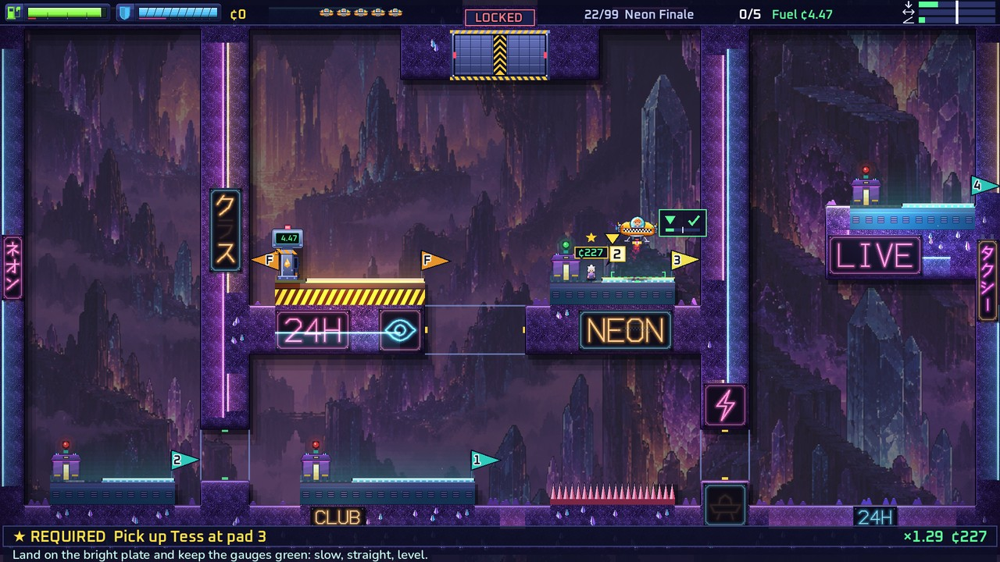
</p>

GraviFare is a 2D arcade taxi game: you fly a hover taxi through **99 levels in 9 sectors**, pick up passengers, drop them
at the right platform and land as gently as you can. Fuel costs credits, every dent costs hull – and the taxi has momentum.
A homage to the flying-taxi genre, with its own world, levels, art and sound. Besides the career there is a **day shift**
and a **night shift** every day, **Overtime** as a roguelike mode and a **level editor** for your own levels.

## Trailer

<p align="center">
  <a href="docs/media/trailer_en.mp4">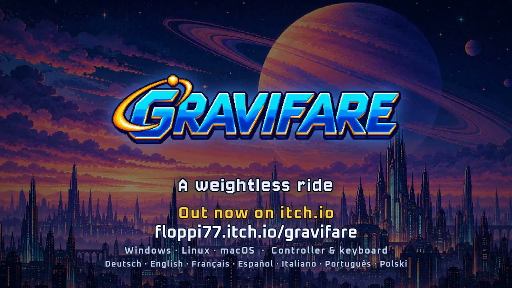</a><br>
  <sub>▶ Watch the trailer (1080p60, 72 s) · <a href="docs/media/trailer_de.mp4">Deutsche Version</a></sub>
</p>

Everything in the trailer comes from the real game and its 99 handmade levels (autopilot flights recorded with Godot's Movie Maker); cutting, camera and effects are scripted, see [tools/trailer](tools/trailer/README.md) (German).

## Gallery

| | |
|---|---|
| 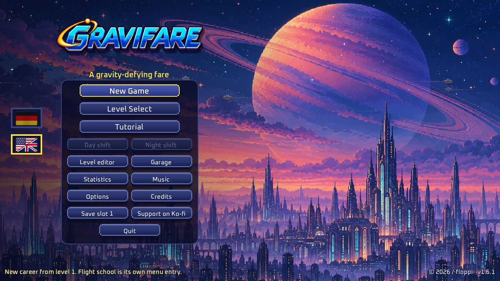 | 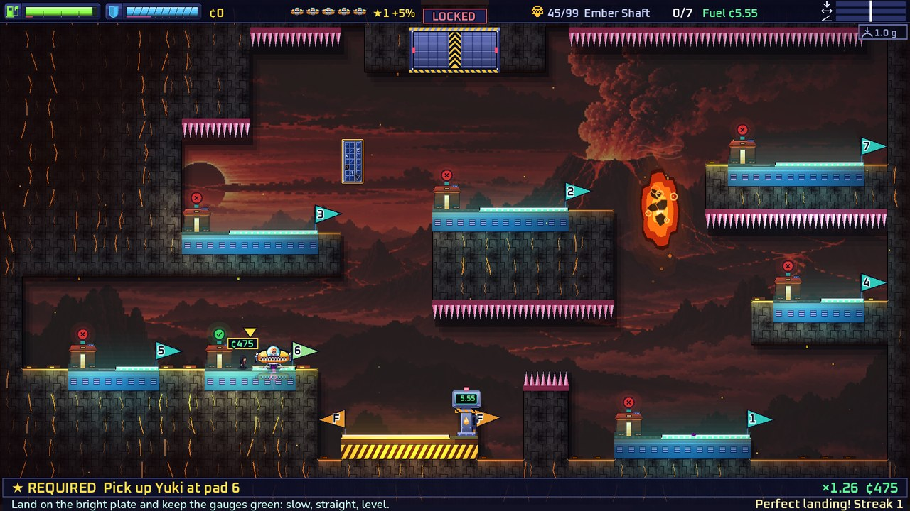 |
| **Main menu** | **Sector 5 – heat and lava bubbles in rhythm** |
| 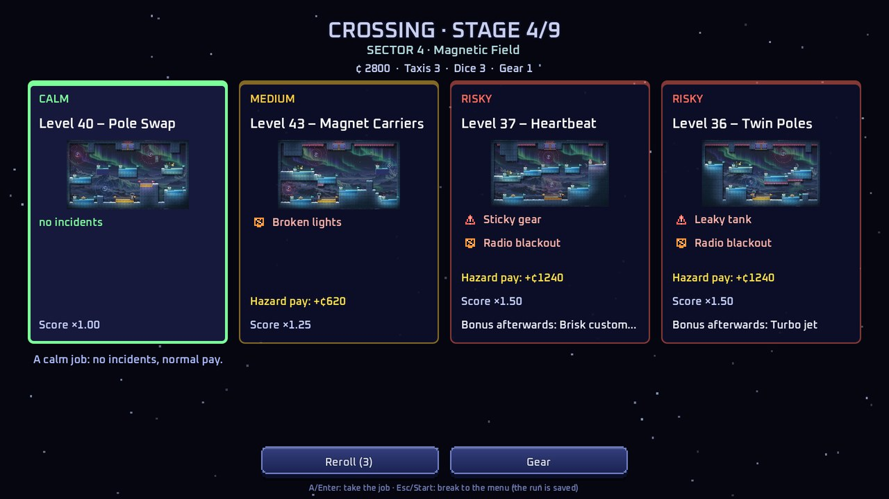 | 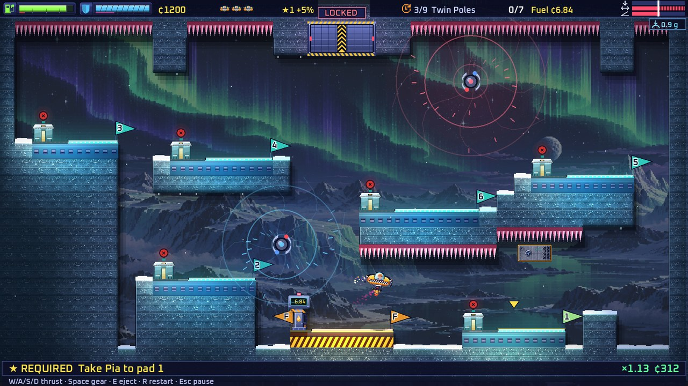 |
| **Overtime (roguelike) – pick a job at the crossing** | **Overtime – incidents change how the taxi handles (here: weak side jet)** |
|  | 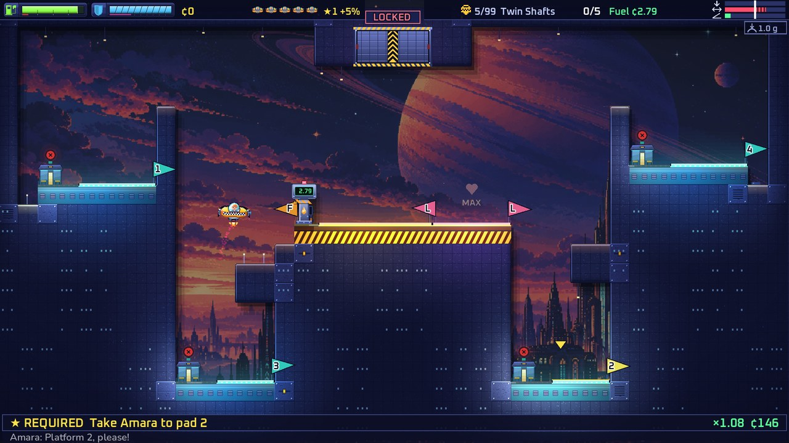 |
| **Flight school with an instructor (voice, subtitles, hints)** | **Sector 1 – passengers, fuel station, gate** |
| 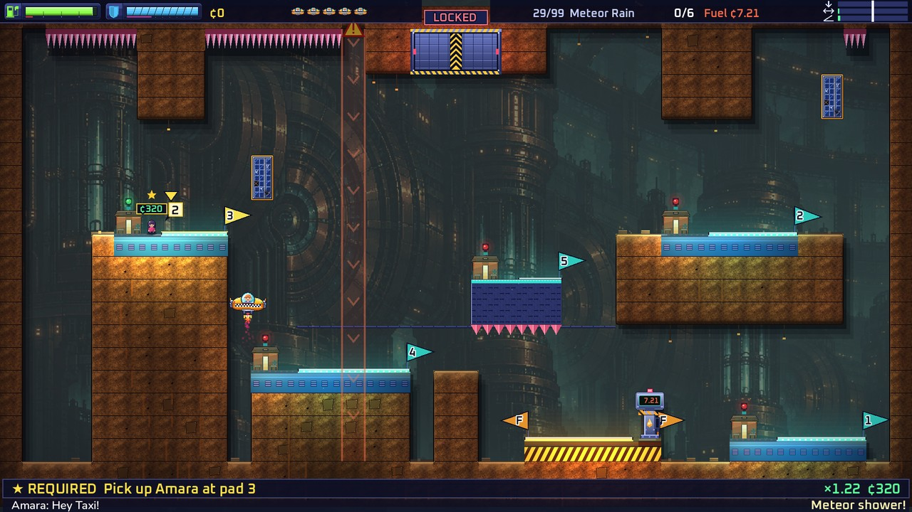 | 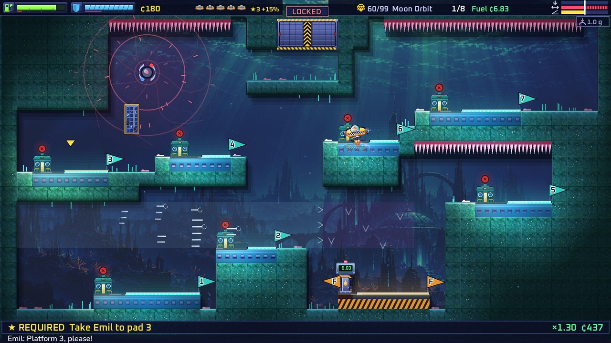 |
| **Sector 3 – moving platforms** | **Sector 6** |
|  | 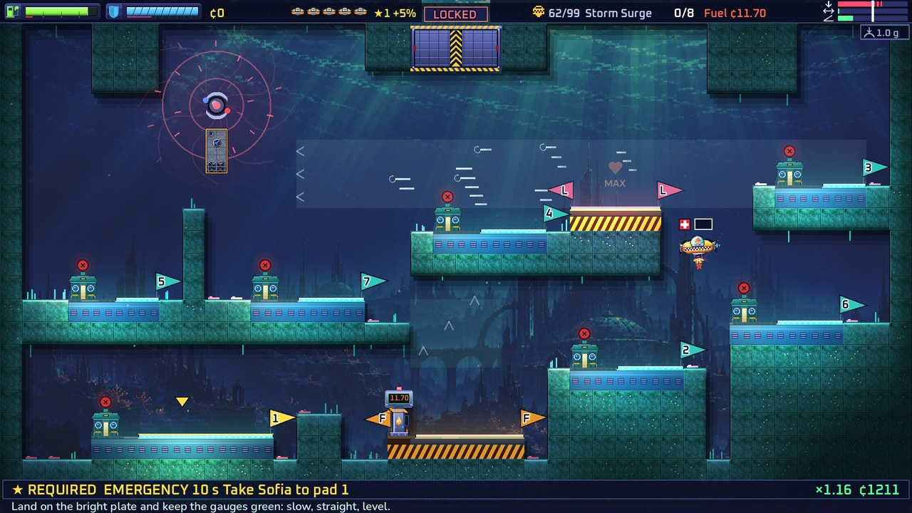 |
| **Neon Canyons – neon signs made of tubes** | **Emergency – passenger with a deadline and countdown** |
| 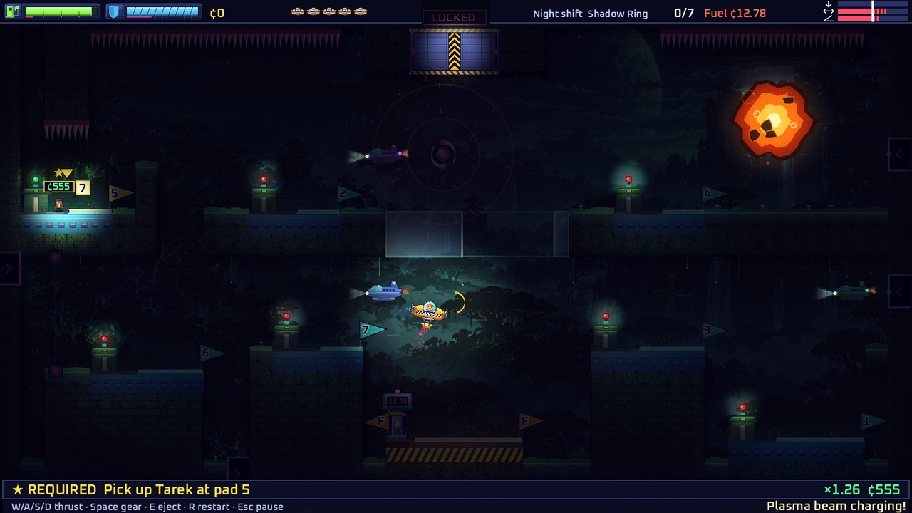 | 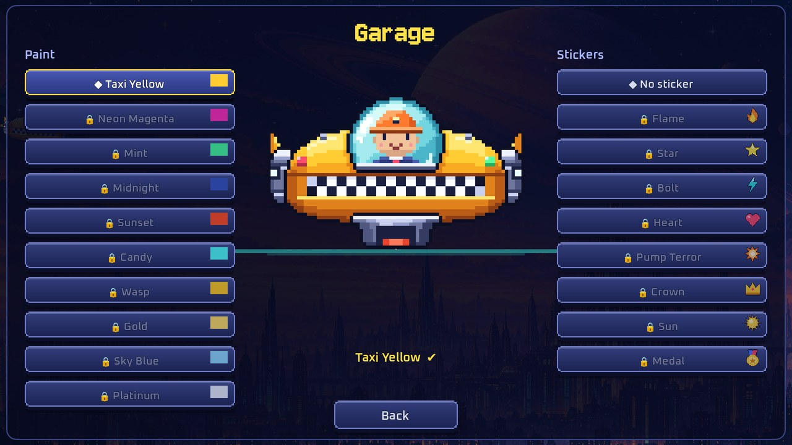 |
| **Night shift – in the dark only lamps and headlights glow** | **Garage – paint jobs and stickers** |
| 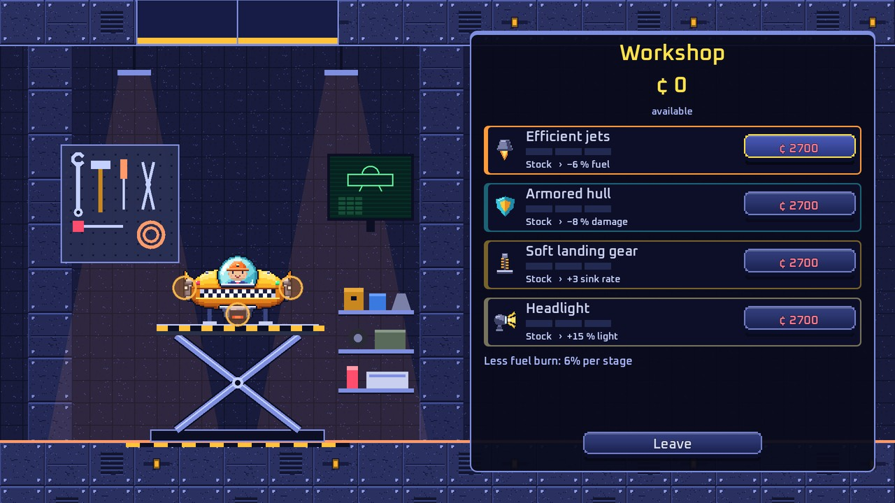 | 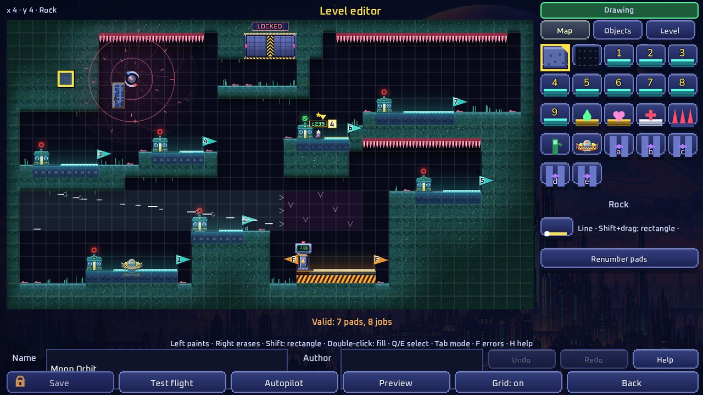 |
| **Workshop – upgrade jets, hull, landing gear and headlight** | **Level editor – build, test and share your own levels** |

## What's inside

- **99 handmade levels in 9 sectors** with rising difficulty: gates, moving platforms, meteors, heat, lava bubbles, ambient traffic,
  changing gravity. Every level was built, tuned and flown through by hand – nothing is procedurally generated.
- **Flight school:** a fully voiced tutorial with a flight instructor covers thrust, landing gear, the landing light, refuelling, the taxi station and passengers.
- **Career with lives and credits:** fares, fuel costs, repairs, replacement taxis and a **workshop** after each sector
  (jets, hull, landing gear, headlight). Game over resets the sector and every upgrade loses one level. Special passengers: **VIP** (pays almost double, little patience) and **Emergency** (double fare, deadline in seconds).
- **Landing assist** right at the taxi, medals (time, clean, pro), best-time ghost and **watch best flight** in the level select, and a **garage** with paint jobs and stickers.
- **Day shift** (unlocked after completing sector 1): every day a brightly lit map from the levels you have already beaten, plus a **daily rule** that changes how you fly – windy day, fog, mirror world, thin tank, glass roof, rush hour or tailwind, shuffled across the weekdays every week. A **daily goal** (express, precision, clean or profit) earns bronze, silver or gold. Fly every day to build a streak that unlocks paint jobs and stickers; your best flight of the day flies along as a ghost.
- **Night shift** (unlocked after completing sector 4): one shift a day of **9 maps**, one per sector, getting darker until only lamps and headlights are left. Everyone flies the same route with the same jobs that day, and there is **only one attempt**. Required passengers have no time limit; you are scored on waiting time, landings, hull and near misses, plus taxis and credits left. At the end you get a **grade from S to E**.
- **Overtime** – the roguelike mode (unlocked after completing sector 6, or right away when creating a new save): 9, 18 or 27 stages through all sectors. At every crossing you pick a job with incidents that can change how your taxi handles a lot from one level to the next (hot jet, sticky gear, sluggish jets, weak side jet, slick hull …) or go after your money (cash only, tax audit). Pit stops offer gear from 46 parts, plus pacts, licenses, ranks, overtime levels and a leaderboard. Seed of your choice; the levels stay the handmade ones.
- **Level editor:** build your own levels (editor with the real game view, mouse, keyboard and controller) and import and play shared ones (a code from the clipboard or a file), strictly validated and kept apart from the career. A level can only be saved once its creator has solved it by hand ([format and rules](docs/COMMUNITY.md)).
- **Voice acting** for passengers (14 different voices, chosen at random per passenger), fuel attendant, dispatch and the instructor, **German, English, French, Spanish, Italian, Portuguese and Polish** with subtitles.
- **Soundtrack** of 23 music themes with three layers each (C64 and Amiga sound) and a music player.
- **Controls:** keyboard and gamepad (Xbox layout) with rumble, fully remappable, see [CONTROLS.md](CONTROLS.md) (German).
- **Display:** 16:9, 1440p/2160p and ultrawide, three save slots.

## Download and play

Ready-made packages for **Windows (x86-64)**, **Linux (x86-64)** and **macOS (Apple Silicon and Intel)** are on the
[Releases](https://github.com/floppi77/gravifare/releases/latest) page. Unzip and run:

| Platform | File | Start |
|---|---|---|
| Windows | `GraviFare-<version>-windows-x86_64.zip` | `gravifare.exe` |
| Linux | `GraviFare-<version>-linux-x86_64.zip` | `./gravifare.x86_64` (`chmod +x` if needed) |
| macOS | `GraviFare-<version>-macos-universal.zip` | `GraviFare.app` (unsigned: right-click › Open) |

Checksums are in `SHA256SUMS.txt`. The packages are not code-signed, so Windows and macOS warn on first launch.

## Build from source

Requires Godot 4.7.x and the matching export templates:

```bash
godot --headless --import                # once after checkout
godot --path .                           # run the game
godot --headless -s tests/test_runner.gd # tests (over 4200 checks)
tools/export_release.sh                  # packages for Linux, Windows, macOS in build/release/
```

## Provenance and licences

Background images and logo are AI-generated. All voices are synthetic: passengers, fuel attendant and dispatch use Qwen3-TTS (Apache-2.0);
the flight instructor in the tutorial and ten more passenger voices are **Built with Fish Audio** (Drama 3). Third-party material: [THIRD_PARTY_NOTICES.md](THIRD_PARTY_NOTICES.md), [THIRD_PARTY_LICENSES.md](THIRD_PARTY_LICENSES.md), [CREDITS.md](CREDITS.md).
The title is provisional. **Licence:** free for non-commercial use – code under [PolyForm Noncommercial 1.0.0](LICENSE), content (art, music, voices, levels) under [CC BY-NC-SA 4.0](LICENSE-ASSETS.md).

---

## Starten
```bash
godot --path .                                  # Spiel (Godot 4.7.x)
godot --path . -- --level=s1_01                 # bestimmtes Level (data/levels/<id>.json)
godot --headless -s tests/test_runner.gd        # Tests
godot --headless -s tools/run_bot.gd            # Autopilot fliegt alle Level
python3 tools/art/gen_art.py                    # Pixel-Art neu erzeugen (Taxi/Fahrgäste: tools/art/aseprite/)
tools/export_linux.sh                           # Linux-Build nach build/linux/ (mit Lizenztexten)
tools/make_level_shots.sh                       # Vorschaubilder der Levelauswahl
tools/make_sector_sheets.sh                     # Sektor-Übersichten docs/levels/sektor_<n>.jpg
```
Nach frischem Checkout einmal `godot --headless --import` ausführen (baut den Klassen-Cache).

## Aufbau
| Pfad | Inhalt |
|---|---|
| `src/core/` | Physik (`taxi_sim`), Auftragslogik (`run`), Leveldaten, Autopilot (`bot`), Parameter (`tuning`), Eingabe, Lokalisierung |
| `src/game/` | Szenen und Darstellung (Welt, Taxi, HUD, Hintergrund) |
| `data/levels/` | ein JSON pro Level |
| `data/i18n/` | Texte `de.json`, `en.json` |
| `tests/`, `tools/` | Testläufer, Bot-Harness, Asset-Generatoren |
