<p align="center">
  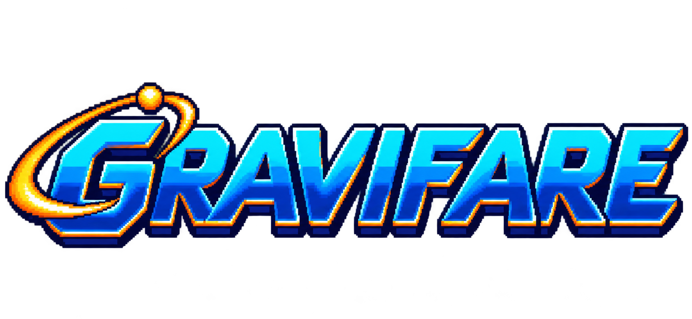
</p>

<p align="center"><a href="#deutsch">Deutsch</a> · <a href="#english">English</a></p>

<p align="center"><b>Eine schwerelose Fahrt · A weightless ride</b><br>
Ein Schwebetaxi-Arcadespiel in Godot 4.7 – Trägheit, Schwerkraft, präzise Landungen.<br>
A hover-taxi arcade game in Godot 4.7 – inertia, gravity, precise landings.</p>

<p align="center">
  <a href="https://github.com/floppi77/gravifare/actions/workflows/regression.yml"></a>
  <a href="https://github.com/floppi77/gravifare/actions/workflows/security.yml"></a>
  <a href="https://ko-fi.com/floppi77"></a>
</p>

<p align="center">
  <a href="https://github.com/floppi77/gravifare/releases/latest"><b>⬇ Download (Windows · Linux · macOS)</b></a>
</p>

# Deutsch

<p align="center">
  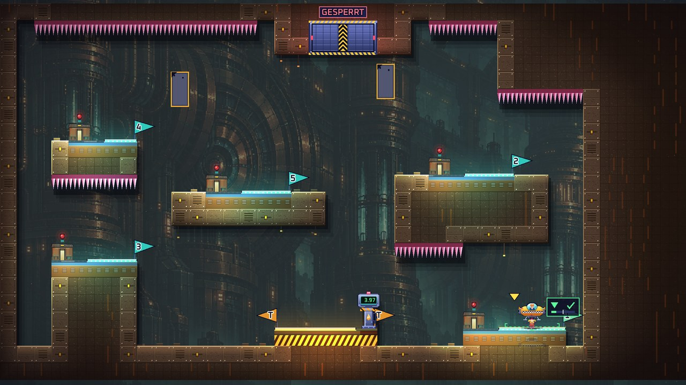
</p>

GraviFare ist ein 2D-Arcade-Taxispiel: Du fliegst ein Schwebetaxi durch **99 Level in 9 Sektoren**, holst Fahrgäste ab,
setzt sie an der richtigen Plattform ab und landest dabei so sanft wie möglich. Der Sprit kostet Credits, jede Beule die
Hülle – und das Taxi hat Schwung. Eine Hommage an das Genre der Flugtaxi-Spiele, mit eigener Welt, eigenen Leveln,
eigener Grafik und eigenem Klang.

## Trailer

<p align="center">
  <a href="docs/media/trailer_de.mp4">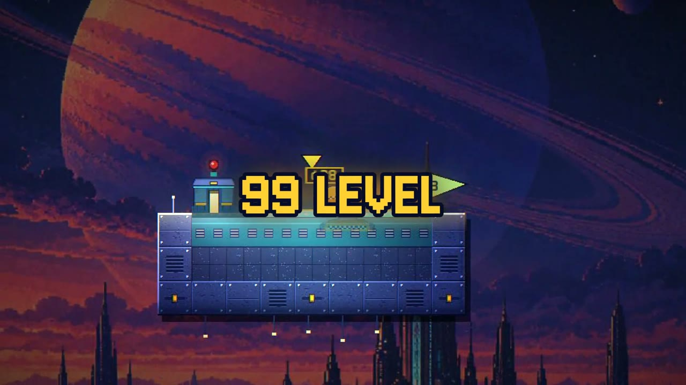</a><br>
  <sub>▶ Trailer ansehen (1080p60, 69 s) · <a href="docs/media/trailer_en.mp4">English version</a></sub>
</p>

Alles im Trailer stammt aus dem echten Spiel (Autopilot-Flüge, aufgenommen mit Godots Movie Maker); Schnitt, Kamera und Effekte entstehen per Skript, siehe [tools/trailer](tools/trailer/README.md).

## Galerie

| | |
|---|---|
| 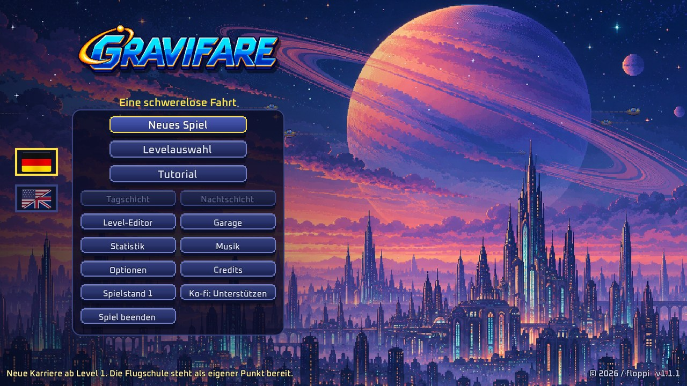 | 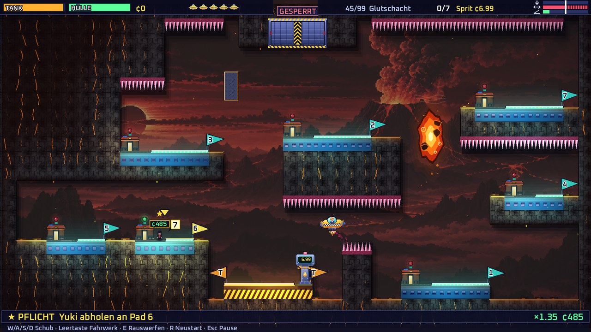 |
| **Hauptmenü** | **Neue Gefahr: Lavablasen im Takt** |
| 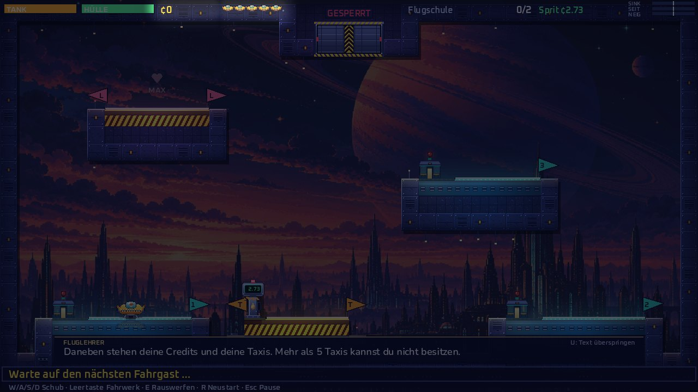 | 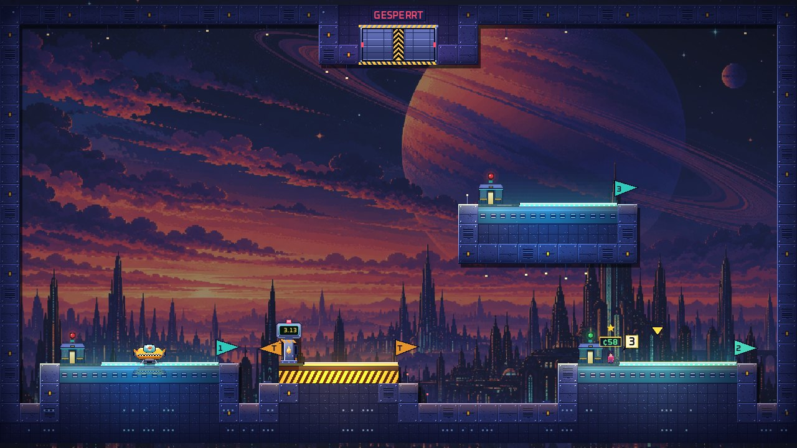 |
| **Flugschule mit Fluglehrer (Stimme, Untertitel, Hinweise)** | **Sektor 1 – Fahrgäste, Tankstelle, Tor** |
|  | 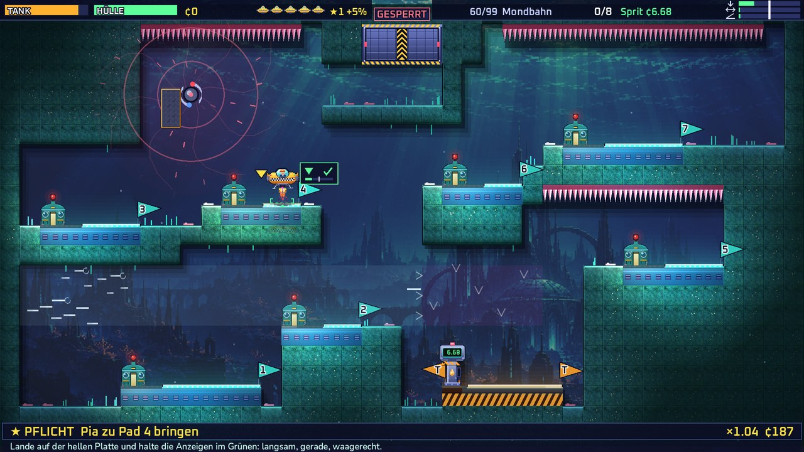 |
| **Sektor 3 – bewegliche Plattformen** | **Sektor 6** |
| 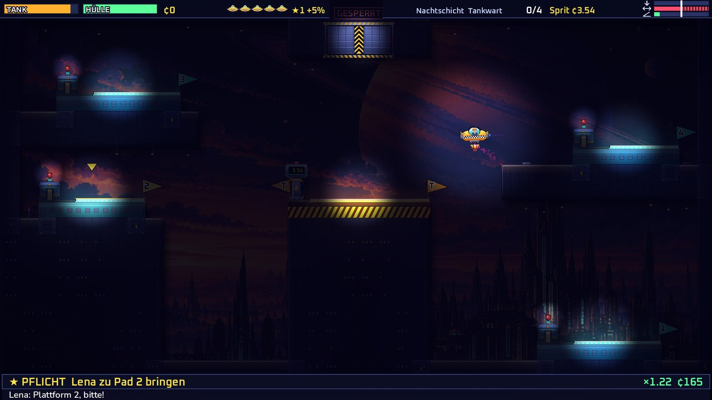 | 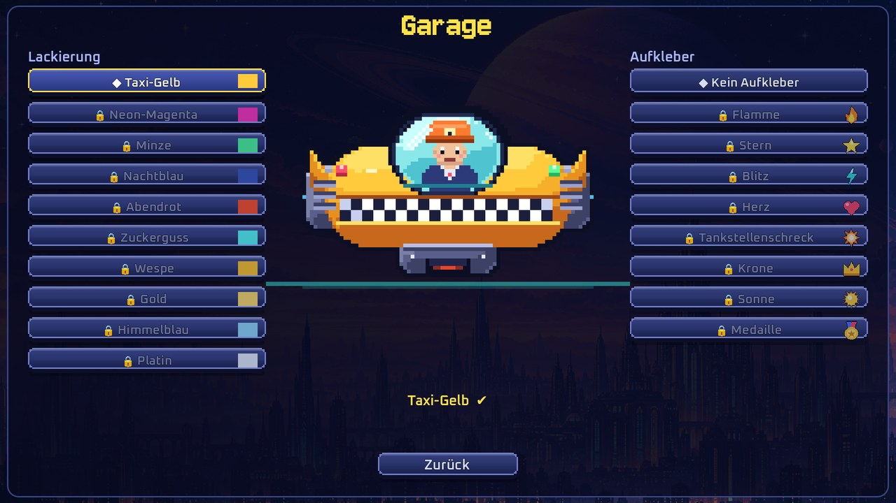 |
| **Nachtschicht – nur das Taxi leuchtet** | **Garage – Lackierungen und Aufkleber** |

## Was drinsteckt

- **99 Level in 9 Sektoren** mit steigender Schwierigkeit: Tore, bewegliche Plattformen, Meteoriten, Hitze, Lavablasen,
  Fremdverkehr, wechselnde Schwerkraft. Jedes Level lässt sich per Autopilot-Test lösen.
- **Flugschule:** ein vertontes Tutorial mit Fluglehrer erklärt Schub, Fahrwerk, Landeampel, Tanken, Taxistation und Fahrgäste.
- **Feldzug mit Leben und Credits:** Fahrpreise, Spritkosten, Reparaturen, Ersatztaxis und eine **Werkstatt** nach jedem Sektor
  (Düsen, Hülle, Tank …). Game Over setzt den Sektor zurück.
- **Landeassistent** direkt am Taxi, Medaillen (Zeit, sauber, Profi), Bestzeit-Geist, **Nachtschicht** mit Zufallsaufträgen,
  **Garage** mit Lackierungen und Aufklebern.
- **Sprachausgabe** für Fahrgäste, Tankwart, Funk-Zentrale und Fluglehrer, **Deutsch und Englisch** mit Untertiteln.
- **Soundtrack** mit 22 Musikthemen in je drei Schichten (C64- und Amiga-Klang) und eigenem Musikplayer.
- **Steuerung:** Tastatur und Gamepad (Xbox-Layout) mit Vibration, alle Tasten frei belegbar, siehe [CONTROLS.md](CONTROLS.md).
- **Anzeige:** 16:9, 1440p/2160p und Ultrawide, drei Speicherplätze.

## Herunterladen und spielen

Unter [Releases](https://github.com/floppi77/gravifare/releases/latest) liegen fertige Pakete für **Windows (x86-64)**,
**Linux (x86-64)** und **macOS (Apple Silicon und Intel)**. Entpacken und starten:

| Plattform | Datei | Start |
|---|---|---|
| Windows | `GraviFare-<Version>-windows-x86_64.zip` | `gravifare.exe` |
| Linux | `GraviFare-<Version>-linux-x86_64.zip` | `./gravifare.x86_64` (ggf. `chmod +x`) |
| macOS | `GraviFare-<Version>-macos-universal.zip` | `GraviFare.app` (nicht signiert: Rechtsklick › Öffnen) |

Prüfsummen stehen in `SHA256SUMS.txt`. Die Pakete sind nicht signiert; Windows und macOS warnen deshalb beim ersten Start.

## Aus dem Quelltext bauen

Godot 4.7.x und die passenden Exportvorlagen vorausgesetzt:

```bash
godot --headless --import                # einmal nach dem Checkout
godot --path .                           # Spiel starten
godot --headless -s tests/test_runner.gd # Tests (rund 2750 Prüfungen)
tools/export_release.sh                  # Pakete für Linux, Windows, macOS nach build/release/
```

Weitere Hinweise und Entwickler-Aufrufe stehen weiter unten und in [DESIGN.md](DESIGN.md), [LEVELS.md](LEVELS.md), [TESTING.md](TESTING.md).

## Herkunft und Lizenzen

Die Hintergrundbilder und das Logo wurden mit ChatGPT Astra 6.0 erzeugt. Die Sprecherstimmen sind künstlich: Fahrgäste, Tankwart und Zentrale
mit Qwen3-TTS (Apache-2.0), die Fluglehrer-Stimme im Tutorial **Built with Fish Audio** (Drama 3). Fremdbestandteile: [THIRD_PARTY_NOTICES.md](THIRD_PARTY_NOTICES.md), [THIRD_PARTY_LICENSES.md](THIRD_PARTY_LICENSES.md),
[CREDITS.md](CREDITS.md). Der Titel ist vorläufig. **Lizenz:** frei für nicht-kommerzielle Zwecke – Code unter [PolyForm Noncommercial 1.0.0](LICENSE), Inhalte (Grafik, Musik, Stimmen, Level) unter [CC BY-NC-SA 4.0](LICENSE-ASSETS.md).

---

# English

<p align="center">
  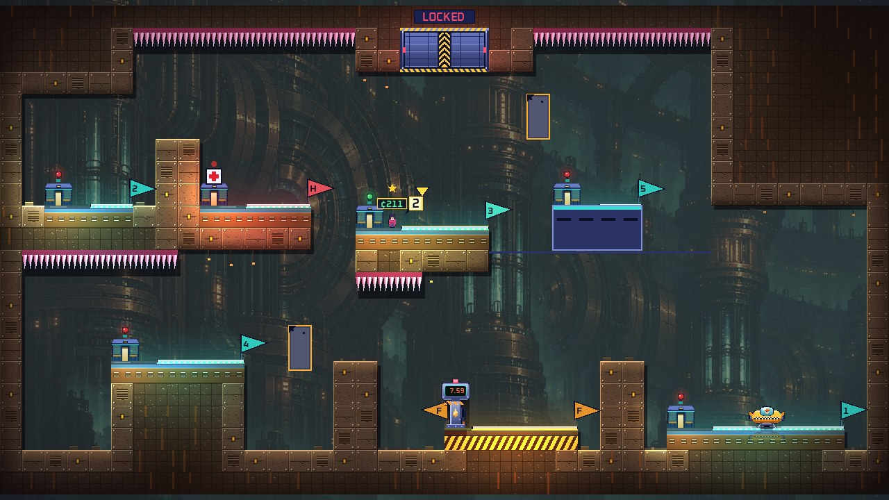
</p>

GraviFare is a 2D arcade taxi game: you fly a hover taxi through **99 levels in 9 sectors**, pick up passengers, drop them
at the right platform and land as gently as you can. Fuel costs credits, every dent costs hull – and the taxi has momentum.
A homage to the flying-taxi genre, with its own world, levels, art and sound.

## Trailer

<p align="center">
  <a href="docs/media/trailer_en.mp4">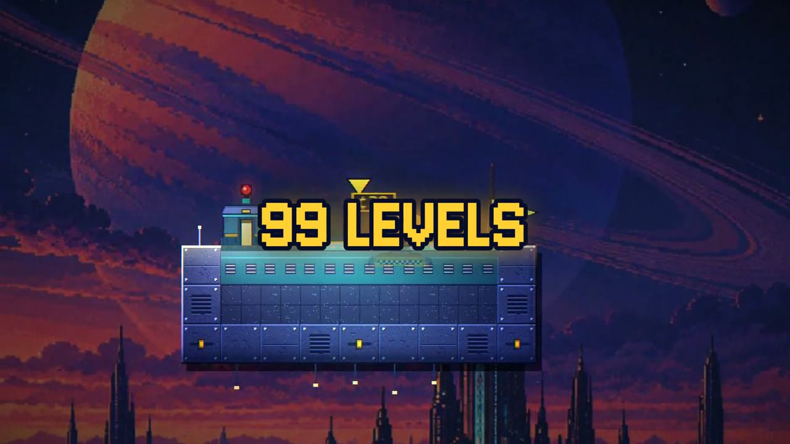</a><br>
  <sub>▶ Watch the trailer (1080p60, 69 s) · <a href="docs/media/trailer_de.mp4">Deutsche Version</a></sub>
</p>

Everything in the trailer comes from the real game (autopilot flights recorded with Godot's Movie Maker); cutting, camera and effects are scripted, see [tools/trailer](tools/trailer/README.md) (German).

## Gallery

| | |
|---|---|
| 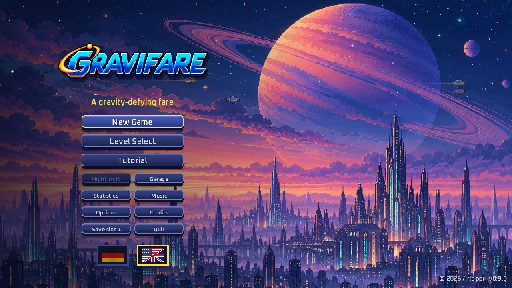 | 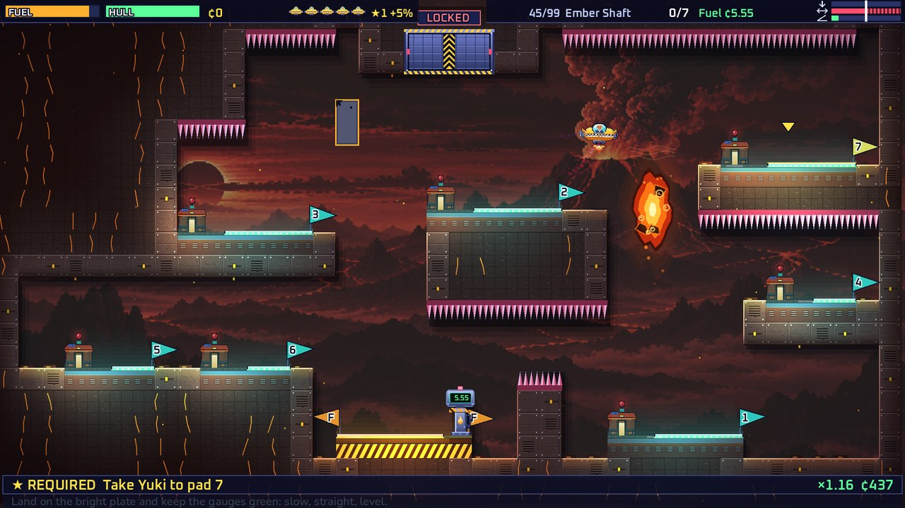 |
| **Main menu** | **New hazard: lava bubbles in rhythm** |
| 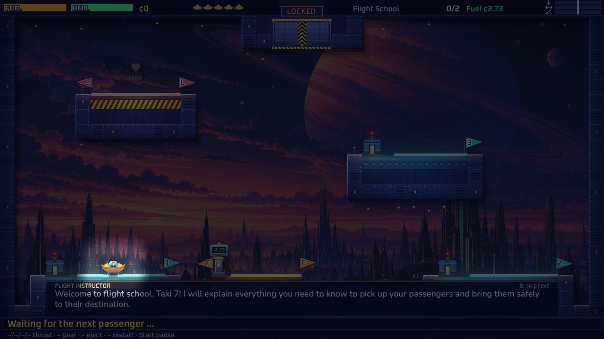 | 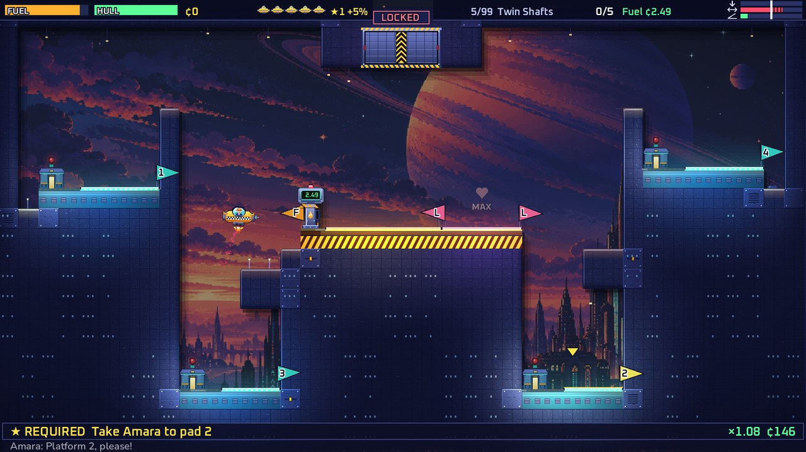 |
| **Flight school with an instructor (voice, subtitles, hints)** | **Sector 1 – passengers, fuel station, gate** |
|  | 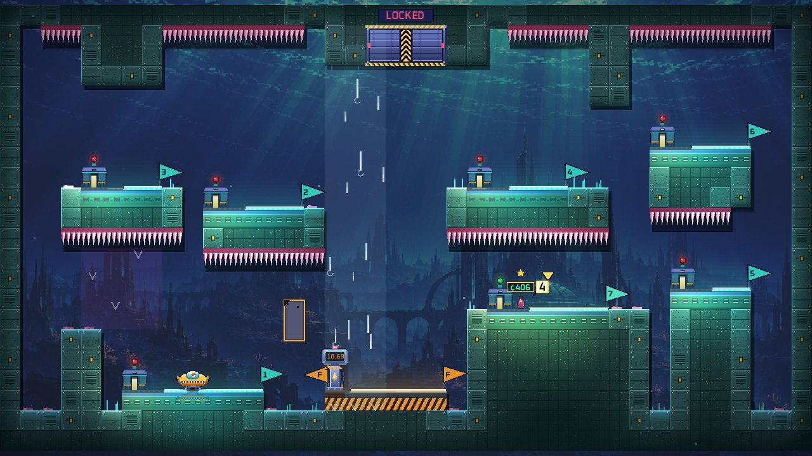 |
| **Sector 3 – moving platforms** | **Sector 6** |
| 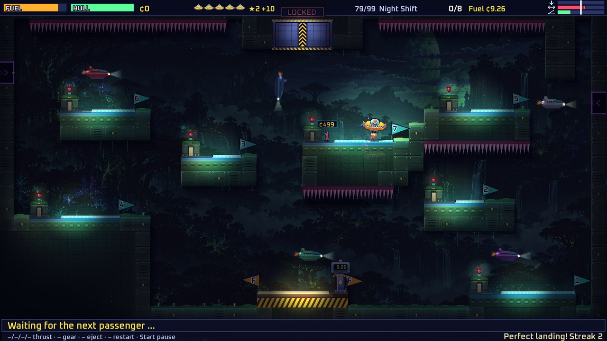 | 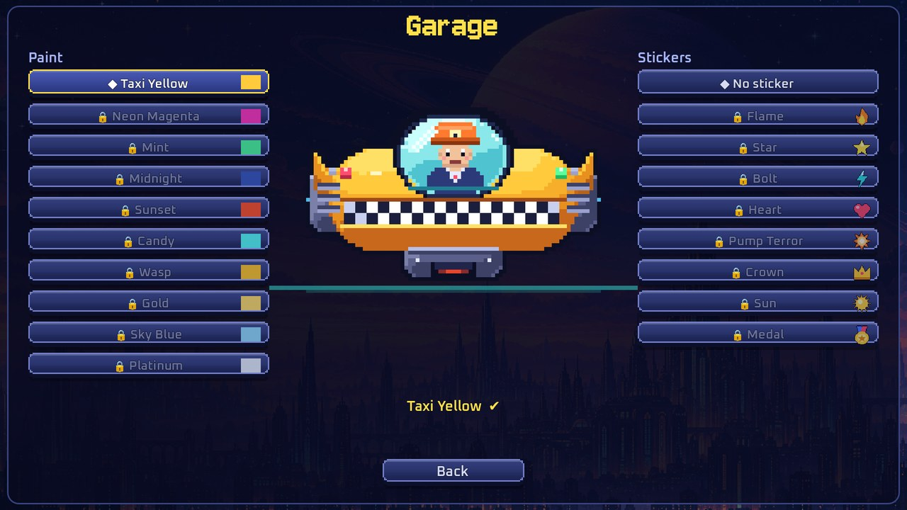 |
| **Night shift – only the taxi glows** | **Garage – paint jobs and stickers** |

## What's inside

- **99 levels in 9 sectors** with rising difficulty: gates, moving platforms, meteors, heat, lava bubbles, ambient traffic,
  changing gravity. Every level is verified solvable by an autopilot test.
- **Flight school:** a fully voiced tutorial with a flight instructor covers thrust, landing gear, the landing light, refuelling, the taxi station and passengers.
- **Campaign with lives and credits:** fares, fuel costs, repairs, replacement taxis and a **workshop** after each sector
  (jets, hull, tank …). Game over resets the sector.
- **Landing assist** right at the taxi, medals (time, clean, pro), best-time ghost, a **night shift** with random jobs,
  and a **garage** with paint jobs and stickers.
- **Voice acting** for passengers, fuel attendant, dispatch and the instructor, **German and English** with subtitles.
- **Soundtrack** of 22 music themes with three layers each (C64 and Amiga sound) and a music player.
- **Controls:** keyboard and gamepad (Xbox layout) with rumble, fully remappable, see [CONTROLS.md](CONTROLS.md) (German).
- **Display:** 16:9, 1440p/2160p and ultrawide, three save slots.

## Download and play

Ready-made packages for **Windows (x86-64)**, **Linux (x86-64)** and **macOS (Apple Silicon and Intel)** are on the
[Releases](https://github.com/floppi77/gravifare/releases/latest) page. Unzip and run:

| Platform | File | Start |
|---|---|---|
| Windows | `GraviFare-<version>-windows-x86_64.zip` | `gravifare.exe` |
| Linux | `GraviFare-<version>-linux-x86_64.zip` | `./gravifare.x86_64` (`chmod +x` if needed) |
| macOS | `GraviFare-<version>-macos-universal.zip` | `GraviFare.app` (unsigned: right-click › Open) |

Checksums are in `SHA256SUMS.txt`. The packages are not code-signed, so Windows and macOS warn on first launch.

## Build from source

Requires Godot 4.7.x and the matching export templates:

```bash
godot --headless --import                # once after checkout
godot --path .                           # run the game
godot --headless -s tests/test_runner.gd # tests (about 2750 checks)
tools/export_release.sh                  # packages for Linux, Windows, macOS in build/release/
```

## Provenance and licences

Background images and logo were generated with ChatGPT Astra 6.0. All voices are synthetic: passengers, fuel attendant and dispatch use Qwen3-TTS (Apache-2.0),
the flight instructor in the tutorial is **Built with Fish Audio** (Drama 3). Third-party material: [THIRD_PARTY_NOTICES.md](THIRD_PARTY_NOTICES.md), [THIRD_PARTY_LICENSES.md](THIRD_PARTY_LICENSES.md), [CREDITS.md](CREDITS.md).
The title is provisional. **Licence:** free for non-commercial use – code under [PolyForm Noncommercial 1.0.0](LICENSE), content (art, music, voices, levels) under [CC BY-NC-SA 4.0](LICENSE-ASSETS.md).

---

## Starten
```bash
godot --path .                                  # Spiel (Godot 4.7.x)
godot --path . -- --level=s1_01                 # bestimmtes Level (data/levels/<id>.json)
godot --headless -s tests/test_runner.gd        # Tests
godot --headless -s tools/run_bot.gd            # Autopilot fliegt alle Level
python3 tools/art/gen_art.py                    # Pixel-Art neu erzeugen
tools/export_linux.sh                           # Linux-Build nach build/linux/ (mit Lizenztexten)
tools/make_level_shots.sh                       # Vorschaubilder der Levelauswahl
tools/make_sector_sheets.sh                     # Sektor-Übersichten docs/levels/sektor_<n>.jpg
```
Nach frischem Checkout einmal `godot --headless --import` ausführen (baut den Klassen-Cache).

## Aufbau
| Pfad | Inhalt |
|---|---|
| `src/core/` | Physik (`taxi_sim`), Auftragslogik (`run`), Leveldaten, Autopilot (`bot`), Parameter (`tuning`), Eingabe, Lokalisierung |
| `src/game/` | Szenen und Darstellung (Welt, Taxi, HUD, Hintergrund) |
| `data/levels/` | ein JSON pro Level |
| `data/i18n/` | Texte `de.json`, `en.json` |
| `tests/`, `tools/` | Testläufer, Bot-Harness, Asset-Generatoren |
